# Module 5: Asynchronous Messaging

This project publishes order events to RabbitMQ and processes them with two workers. The broker keeps each message until a worker acknowledges it. The workers record each `event_id` so a later delivery is not applied twice.

## Architecture

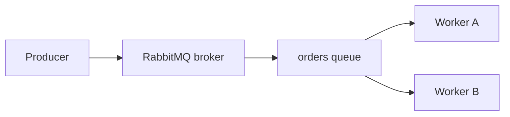


Worker A and Worker B are competing consumers of the same `orders` queue. RabbitMQ delivers each message to only one of them. The other worker does not receive that delivery.

## Components

- **Order Producer** (`producer/order_producer.py`) creates order messages and publishes them to the `orders` queue. With no arguments it publishes three sample orders, each with a new `event_id`. Optional arguments publish one fixed message.
- **RabbitMQ broker** accepts connections from the producer and the workers, stores messages, and delivers each message to one competing consumer. It is started from `compose.yaml` with the `rabbitmq:3-management` image.
- **Durable orders queue** is declared with `durable=True`. Published messages are persistent, so they remain on the queue until a worker acknowledges them.
- **Order Worker** (`worker/order_worker.py`) consumes `orders`, performs the order action, and acknowledges the message. Worker A and Worker B are separate processes. They share `worker/processed_event_ids.txt` and lock that file so they do not update it at the same time.
- **Competing consumers:** both workers consume `orders`. Each delivery is handled by only one worker.


## Message format

Every message is JSON with these fields:

- `event_id` identifies the event. Workers use it to detect a delivery that was already processed.
- `order_id` identifies the order, such as `order-1001`.
- `item_id` identifies the item, such as `item-501`.
- `quantity` is the number of items in the order.

The normal sample orders are `order-1001`, `order-1002`, and `order-1003`.

## Setup

From `module-05-asynchronous-messaging`:

```bash
python3 -m venv .venv
.venv/bin/pip install -r requirements.txt
docker compose up -d
```

`requirements.txt` installs `pika`.

Docker Compose publishes two ports:

- **5672** is the AMQP port. The producer and workers connect to `localhost:5672`.
- **15672** is the RabbitMQ management UI at [http://localhost:15672](http://localhost:15672). The image default login is `guest` / `guest`.


## Run

Use three terminals. Run every command from `module-05-asynchronous-messaging`.

Start Worker A:

```bash
WORKER_NAME=worker-A .venv/bin/python worker/order_worker.py
```

Start Worker B:

```bash
WORKER_NAME=worker-B .venv/bin/python worker/order_worker.py
```

Start the producer with the sample orders:

```bash
.venv/bin/python producer/order_producer.py
```

Publish one message with a fixed `event_id`:

```bash
.venv/bin/python producer/order_producer.py \
  --event-id duplicate-demo-002 \
  --order-id order-duplicate-002 \
  --item-id item-501 \
  --quantity 2
```


## Acknowledgements

Workers use manual acknowledgement (`auto_ack=False`). A new event is acknowledged only after successful processing, once the business action is finished and the `event_id` is recorded. A duplicate is acknowledged without repeating the business action.

`prefetch_count=1` limits each worker to one unacknowledged message. RabbitMQ can give the next message to the other worker, which keeps distribution fair.

## Evidence


### Successful message processing

The producer published the normal sample orders `order-1001`, `order-1002`, and `order-1003`.

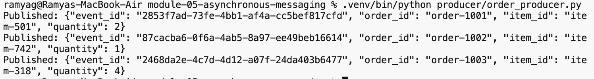

*Producer publishing the three sample orders.*

Worker A processed and acknowledged each sample order:

- `order-1001`, `event_id` `2853f7ad-73fe-4bb1-af4a-cc5bef817cfd`
- `order-1002`, `event_id` `87cacba6-0f6a-4ab5-8a97-ee49beb16614`
- `order-1003`, `event_id` `2468da2e-4c7d-4d12-a07f-24da403b6477`

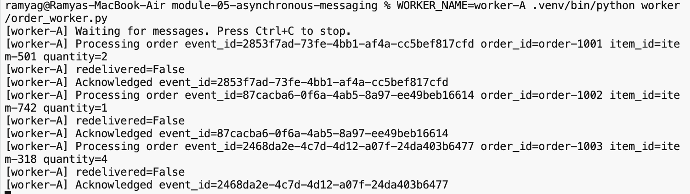

*Worker A acknowledging order-1001, order-1002, and order-1003.*

### Competing consumers

With both workers running, the producer published `order-1001`, `order-1002`, and `order-1003` again.

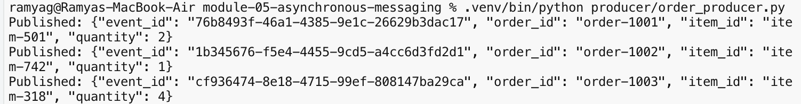

*Producer publishing order-1001, order-1002, and order-1003.*

Worker A processed `order-1001` (`event_id` `76b8493f-46a1-4385-9e1c-26629b3dac17`) and acknowledged it.

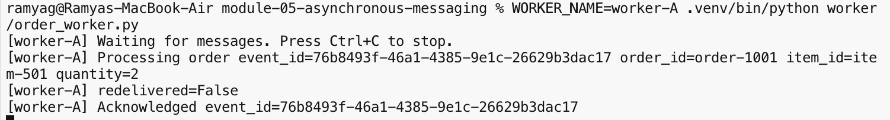

*Worker A processed and acknowledged order-1001.*

Worker B processed `order-1002` (`event_id` `1b345676-f5e4-4455-9cd5-a4cc6d3fd2d1`) and `order-1003` (`event_id` `cf936474-8e18-4715-99ef-808147ba29ca`), and acknowledged both.

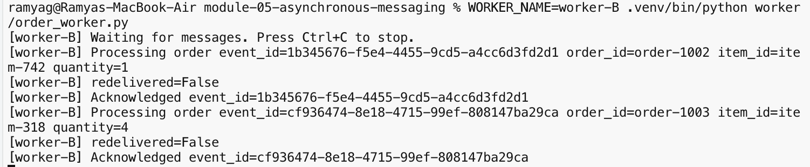

*Worker B processed and acknowledged order-1002 and order-1003.*

Each delivery was handled by only one worker.

### Failure before ACK and redelivery

Worker A received `event_id` `af3b0d4a-5af0-4977-9535-7ba57faf7dbe` (`order-1001`) and exited before ACK. The log shows `Simulating crash before ACK.` and the shell prompt returned without an acknowledgement.

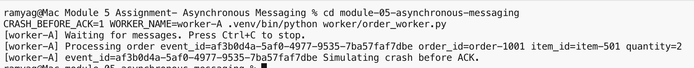

*Worker A received af3b0d4a-5af0-4977-9535-7ba57faf7dbe and exited before ACK.*

Worker B later received the same event with `redelivered=True` and acknowledged it.

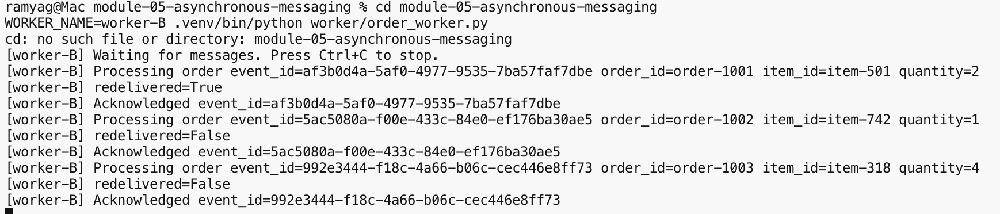

*Worker B acknowledged af3b0d4a-5af0-4977-9535-7ba57faf7dbe with redelivered=True.*

### Duplicate handling

The same `event_id`, `duplicate-demo-002`, was published twice. The first copy was processed. A later copy was detected as a duplicate, was not processed again, and was acknowledged.

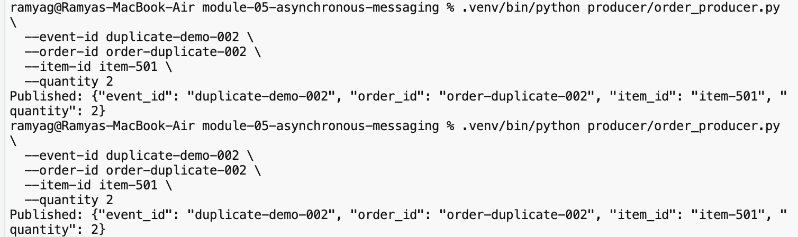

*The producer published duplicate-demo-002 twice.*

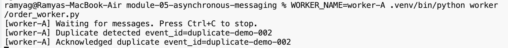

*Worker A logged Duplicate detected and Acknowledged duplicate for duplicate-demo-002, without logging Processing order.*

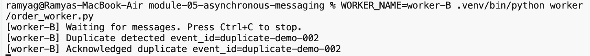

*Worker B logged Duplicate detected and Acknowledged duplicate for duplicate-demo-002, without logging Processing order.*

## Reflection

A message can be delivered more than once because acknowledgement is manual. If a worker receives a message and exits before `basic_ack`, RabbitMQ still treats that message as unacknowledged and delivers it again. That is what happened when Worker A exited before acknowledging `af3b0d4a-5af0-4977-9535-7ba57faf7dbe` and Worker B later received it with `redelivered=True`. Publishing the same `event_id` a second time also creates another delivery after the first one succeeded. Idempotent handling records the `event_id` after the first successful action, then acknowledges a later copy without repeating the business action, so the queue is cleared and the order is not applied twice.

## Cleanup

Stop each worker with Ctrl+C in its terminal.

Stop RabbitMQ from `module-05-asynchronous-messaging`:

```bash
docker compose down
```

